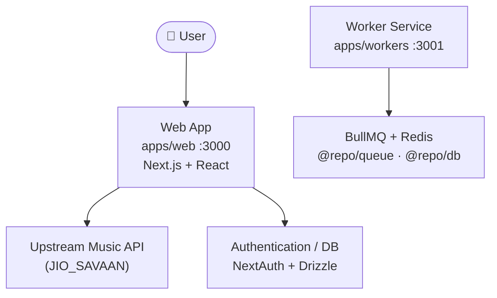

<div align="center">

# 🎵 CatchMusic

### Catch your favorite beats. Play anytime.

Discover music, play your favorite tracks, organize playlists, and cache supported songs for offline listening.

<br />

[](https://catch-music.vercel.app/)
[](https://github.com/vanshsharma3777/catch-music)


[**Live Demo**](https://catch-music.vercel.app/) · [**Report a Bug**](https://github.com/vanshsharma3777/catch-music/issues) · [**Request a Feature**](https://github.com/vanshsharma3777/catch-music/issues)

</div>

---

## 📑 Table of Contents

- [About](#-about)
- [Features](#-features)
- [Tech Stack](#-tech-stack)
- [Project Structure](#-project-structure)
- [Architecture](#-architecture)
- [Getting Started](#-getting-started)
- [Available Commands](#-available-commands)
- [Browser Song Caching](#-browser-song-caching)
- [Third-Party Services and Attribution](#-third-party-services-and-attribution)
- [Deployment](#-deployment)
- [Contributing](#-contributing)
- [Reporting Issues](#-reporting-issues)
- [License](#-license)
- [Author](#-author)

---

## 📖 About

**CatchMusic** is a web-based music application built to make discovering and enjoying music simple. Search for tracks, listen through the built-in player, save songs you like, create playlists, and cache supported tracks in your browser for offline listening.

The project uses a **Bun + Turborepo monorepo** to organize its web app, worker service, and shared packages.

🔗 **Live demo:** [https://catch-music.vercel.app/](https://catch-music.vercel.app/)

---

## ✨ Features

| Feature | Description |
| --- | --- |
| 🔍 **Music search** | Search for tracks and discover new music. |
| ▶️ **Music player** | Listen using the app's built-in playback interface. |
| 💾 **Browser song caching** | Cache supported audio for offline playback, subject to browser storage limits and implementation. |
| ❤️ **Liked songs** | Keep track of songs you want to revisit. |
| 📂 **Playlists** | Create and manage your own playlists. |
| 👤 **User profiles** | Access profile information and music preferences. |
| 🎤 **Favorite artists** | Personalize your profile with your favorite singers or artists. |
| 📱 **Responsive UI** | Use the app on supported desktop and mobile browsers. |

> [!NOTE]
> Feature availability may depend on authentication, browser support, and the current deployment configuration.

---

## 🧰 Tech Stack

### Web application (`apps/web`)

| Technology | Purpose |
| --- | --- |
| [Next.js 16](https://nextjs.org/) | Web framework and API routes |
| [React 19](https://react.dev/) | Component-based UI |
| [TypeScript](https://www.typescriptlang.org/) | Type-safe application code |
| [Tailwind CSS 3](https://tailwindcss.com/) | Styling |
| [NextAuth.js 4](https://next-auth.js.org/) | Authentication and sessions |
| [Drizzle ORM](https://orm.drizzle.team/) | Type-safe database queries |
| [@auth/drizzle-adapter](https://authjs.dev/reference/adapter/drizzle) | Authentication database adapter |
| [@upstash/redis](https://github.com/upstash/redis-js) | Redis integration |
| [Axios](https://axios-http.com/) | HTTP requests |
| [Lucide React](https://lucide.dev/) / [React Icons](https://react-icons.github.io/react-icons/) | Icons |
| [Framer Motion](https://www.framer.com/motion/) / Motion | UI animations |
| [Vercel Analytics](https://vercel.com/analytics) | Website analytics |

### Worker service (`apps/workers`)

| Technology | Purpose |
| --- | --- |
| [Bun](https://bun.sh/) | Runtime |
| [BullMQ](https://docs.bullmq.io/) | Background job queues |
| [ioredis](https://github.com/redis/ioredis) | Redis connectivity |
| [Drizzle ORM](https://orm.drizzle.team/) | Database access |
| `@repo/db` | Shared database package |
| `@repo/queue` | Shared queue package |

### Monorepo tooling

| Tool | Purpose |
| --- | --- |
| [Bun 1.3.6](https://bun.sh/) | Package manager and JavaScript/TypeScript runtime |
| [Turborepo 2.8](https://turbo.build/repo) | Runs tasks across workspaces |
| Shared packages | Database, queue, UI, ESLint, and TypeScript configuration |

---

## 🏗️ Project Structure

```text
catch-music/
├── apps/
│   ├── web/                  # Next.js web application
│   │   ├── app/              # App Router pages, layouts, and API routes
│   │   └── package.json
│   └── workers/              # Worker service
│       ├── src/
│       │   └── index.ts      # Worker entry point
│       └── package.json
├── packages/
│   ├── db/                   # Shared database package (@repo/db)
│   ├── queue/                # Shared queue package (@repo/queue)
│   ├── ui/                   # Shared UI package (@repo/ui)
│   ├── eslint-config/        # Shared ESLint configuration
│   └── typescript-config/    # Shared TypeScript configuration
├── package.json              # Root scripts and Bun workspaces
├── turbo.json                # Turborepo task configuration
└── bun.lock                  # Bun lockfile
```

> [!NOTE]
> Exact package files may vary as the project evolves.

---

## 🧱 Architecture



The web app and worker run as **separate workspace services**. BullMQ uses Redis for background job processing, while `@repo/db` and `@repo/queue` provide shared functionality across the workspace.

---

## 🚀 Getting Started

### Prerequisites

- [Bun](https://bun.sh/) `1.3.6`
- [Git](https://git-scm.com/)
- Access to the database, Redis, authentication, and music API configuration required by the application

### 1. Clone the repository

```bash
git clone https://github.com/vanshsharma3777/catch-music.git
cd catch-music
```

### 2. Install dependencies

Run this from the repository root:

```bash
bun install
```

Bun installs dependencies for all configured workspaces, including the web app, worker, and shared packages.

### 3. Configure environment variables

Create the environment files expected by the web app and the worker (for the web app, this is typically `apps/web/.env.local`).

```env
# Upstream music API
JIO_SAVAAN=your_music_api_base_url

# Upstash Redis (REST)
UPSTASH_REDIS_REST_URL=your_upstash_redis_rest_url
UPSTASH_REDIS_REST_TOKEN=your_upstash_redis_rest_token
```

Depending on your setup, you may also need:

| Variable group | Used for |
| --- | --- |
| Database connection details | Drizzle ORM and `@repo/db` |
| NextAuth secret, URL, and provider credentials | Authentication |
| Redis connection details | BullMQ / ioredis in the worker |
| Other external API keys | Any additional services referenced in the code |

> [!WARNING]
> Never commit secrets, passwords, API tokens, or populated environment files to Git. Configure the web app and worker environments in their respective deployment platforms.

### 4. Start development servers

From the repository root:

```bash
bun run dev
```

Turborepo runs the `dev` tasks of all configured workspaces. The web app starts Next.js on port `3000`, and the worker script sets `PORT=3001`.

To run each service independently:

```bash
# Next.js web app
bun run dev --filter=web

# Worker service
bun run dev --filter=worker
```

Open [http://localhost:3000](http://localhost:3000) to use the web application.

> [!TIP]
> **Windows users:** the worker script uses `PORT=3001 bun src/index.ts`, which is Unix-shell syntax. In PowerShell, use a cross-platform approach such as [`cross-env`](https://www.npmjs.com/package/cross-env), or update the script to be Windows-compatible. Port `3001` is only used if the worker code reads `PORT` and starts a listener.

### 5. Build the project

```bash
bun run build
```

This runs `turbo run build` from the root. The web workspace defines `next build`; the worker does not currently define a `build` script, so it is not built unless you add one.

### 6. Start production services

```bash
# Web app (build it first)
bun run start --filter=web

# Worker service
bun run start --filter=worker
```

The web app uses `next start`, and the worker runs `bun src/index.ts`.

---

## 🧪 Available Commands

Run these from the repository root:

| Command | Description |
| --- | --- |
| `bun install` | Install all workspace dependencies |
| `bun run dev` | Run development tasks through Turborepo |
| `bun run dev --filter=web` | Start only the web app's dev server |
| `bun run dev --filter=worker` | Start only the worker's dev script |
| `bun run build` | Run configured build tasks |
| `bun run lint` | Run configured lint tasks |
| `bun run check-types` | Run TypeScript type checks |
| `bun run test --filter=web` | Run `bun test` in the web workspace |

---

## 💾 Browser Song Caching

CatchMusic can cache supported songs in **browser storage** for potential offline playback. This is separate from Redis or any server-side caching.

- Cached audio uses storage on the user's device.
- Available storage varies by browser, operating system, and free disk space.
- Clearing browser site data can remove cached audio.
- Offline playback requires the audio to be fully cached and still available.
- Cache writes can fail if the storage quota is exceeded or storage is unavailable.

---

## 🔐 Third-Party Services and Attribution

- CatchMusic uses an upstream music API configured through `JIO_SAVAAN`. This service may be unofficial or independently operated and is not necessarily affiliated with JioSaavn.
- CatchMusic is an independent project and is **not** an official JioSaavn application.
- Music availability and playback may depend on upstream service availability and applicable restrictions.
- Rights to music, artwork, metadata, and other third-party content remain with their respective owners.
- Review applicable service terms and copyright requirements before using or redistributing content.

---

## ☁️ Deployment

🌐 **Live website:** [catch-music.vercel.app](https://catch-music.vercel.app/)

- Configure the web app's environment variables in [Vercel](https://vercel.com/) or your chosen hosting platform.
- Configure the worker's environment variables on the platform where the worker runs.
- Make sure both services use the correct Redis and database resources.
- Verify production authentication URLs and callback settings.
- `UPSTASH_REDIS_REST_URL` and `UPSTASH_REDIS_REST_TOKEN` are passed explicitly to Turborepo build tasks, so they must be available at build time.
- Deploy the worker separately if your web hosting platform does not support persistent worker processes.

---

## 🤝 Contributing

Contributions, bug reports, and suggestions are welcome!

1. **Fork** the [repository](https://github.com/vanshsharma3777/catch-music/fork).
2. **Create a feature branch:**
   ```bash
   git checkout -b feat/your-feature
   ```
3. **Make your changes** and run the relevant checks (`bun run lint`, `bun run check-types`).
4. **Commit your changes:**
   ```bash
   git commit -m "feat: describe your change"
   ```
5. **Push the branch** and open a [pull request](https://github.com/vanshsharma3777/catch-music/pulls).

> [!IMPORTANT]
> Please do not commit secrets, populated environment files, or unrelated generated files.

---

## 🐛 Reporting Issues

Found a bug? [Open an issue](https://github.com/vanshsharma3777/catch-music/issues/new) and include:

- Steps to reproduce the problem
- Expected and actual behavior
- Relevant error messages or screenshots

Please remove secrets and personal information from logs before sharing them.

---

## 📄 License

Check the repository's [`LICENSE`](https://github.com/vanshsharma3777/catch-music/blob/main/LICENSE) file for the terms governing use, modification, and redistribution. If no license is present, do not assume the code is available for unrestricted reuse.

---

## 👨‍💻 Author

**Vansh Sharma**

[](https://github.com/vanshsharma3777)

- 📦 Repository: [catch-music](https://github.com/vanshsharma3777/catch-music)
- 🌐 Live website: [catch-music.vercel.app](https://catch-music.vercel.app/)

---

<div align="center">

**Catch your favorite beats. Play anytime. 🎶**

⭐ If you like this project, consider giving it a star!

</div>
